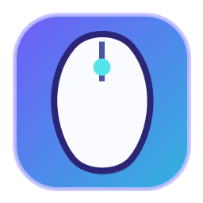
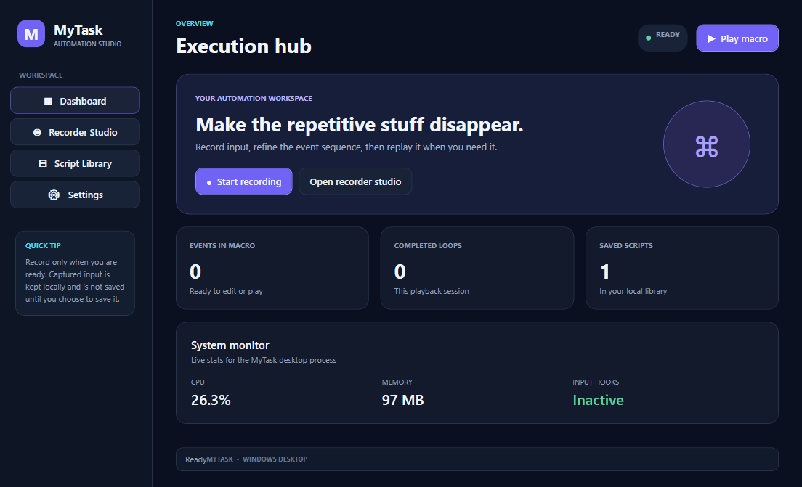

<div align="center">
  
  <h1>MyTask</h1>
  <p><strong>A desktop automation studio for repeatable Windows tasks.</strong></p>
  <p>Record keyboard and mouse actions, refine the sequence, and replay it with configurable hotkeys.</p>
  <p>
    <a href="https://github.com/jackjackque1147-oss/MyTask/releases/latest">
      
    </a>
    
    
  </p>
</div>

## The app



## What you can do

| Feature | Details |
| --- | --- |
| **Execution dashboard** | Start recording or playback, check macro and loop counts, and view CPU, memory, and input-hook status. |
| **Macro recorder** | Explicitly record global keyboard and mouse input, then review the live event stream. |
| **Event editor** | Edit, duplicate, or delete events and add waits, key presses, or mouse clicks. |
| **Macro playback** | Replay recorded delays and actions, pause or stop playback, and choose a finite loop count or **Unlimited**. A short target-switch countdown gives you time to focus the intended app. |
| **Global hotkeys** | Configure shortcuts for recording, playback, stop-all, and pause/resume in Settings. |
| **Script library** | Save and reopen recordings and `.mytask` scripts from your local library. |
| **Custom app icon** | The MyTask mouse icon appears in the app window, executable, installer, and shortcuts. |

> **Current scope:** MyTask is an early MVP. System-tray controls, script syntax highlighting, variable inspection/debugging, conditional task blocks, and system-command actions are not implemented yet.

## Get started

1. Open [GitHub Releases](https://github.com/jackjackque1147-oss/MyTask/releases/latest).
2. Download `MyTask-Setup-vX.Y.Z.exe` to install, or choose the portable executable/ZIP.
3. Launch MyTask from the Start menu or run the portable executable.
4. Select **Start recording** when ready. Review and edit the captured events, then choose **Play macro** to run them.

The Windows x64 release includes its .NET runtime. See the [User Installation Guide](INSTALLATION.md) for setup, checksum verification, troubleshooting, and uninstall details.

## Privacy and safe use

Recording is opt-in. While recording is active, MyTask captures keyboard and mouse input system-wide, including input in other applications. Captured events stay in memory until you choose to save them; MyTask does not upload them. Avoid recording passwords or other sensitive information.

Playback sends input to whichever application is currently active. Use the target-switch countdown to focus the intended app before playback begins. Pausing or stopping playback releases keys and mouse buttons held by the macro.

Default hotkeys are `Ctrl+Alt+F9` (toggle recording), `Ctrl+Alt+F10` (toggle playback), `Ctrl+Alt+F11` (stop all), and `Ctrl+Alt+F12` (pause/resume). Change them in **Settings** if another app already uses one.

## Local data

MyTask stores scripts, recordings, logs, and settings under `%LOCALAPPDATA%\MyTask`:

```text
%LOCALAPPDATA%\MyTask\
├── Scripts/     # Saved scripts
├── Recorded/    # Saved recordings
├── Logs/        # Application logs
└── Config/      # Settings and hotkeys
```

## Built with

- C# and .NET 9
- WPF with MVVM and CommunityToolkit.Mvvm
- Windows low-level keyboard and mouse hooks with `SendInput`

MyTask releases are currently unsigned, so Windows may show a publisher warning. Download releases only from the official repository.
